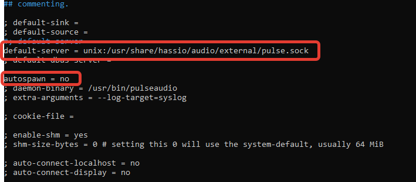
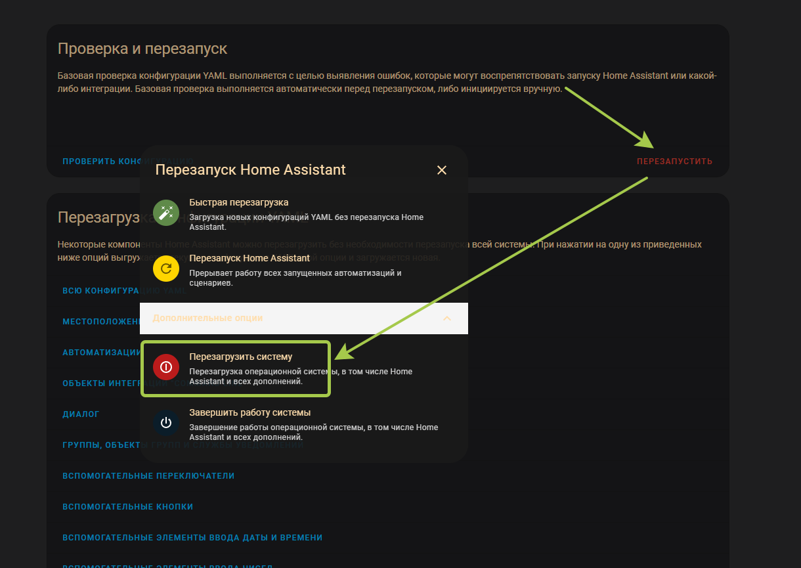
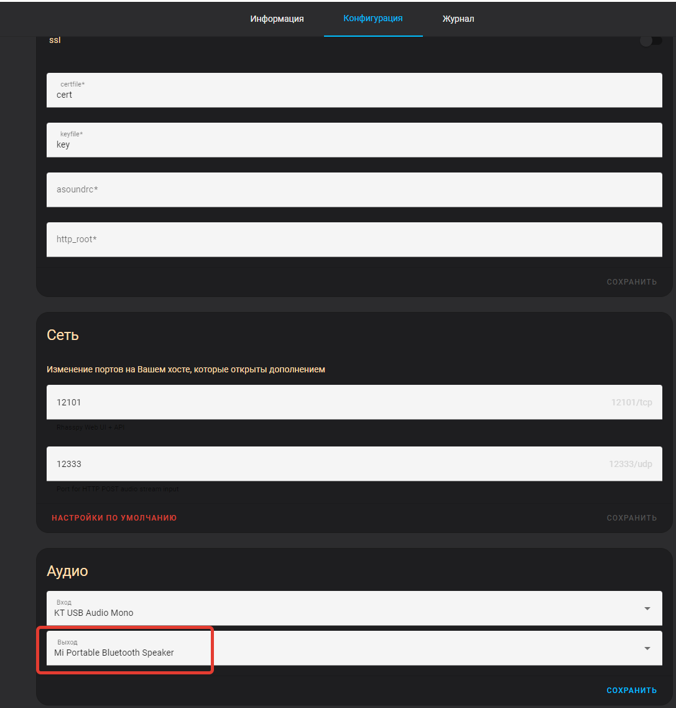
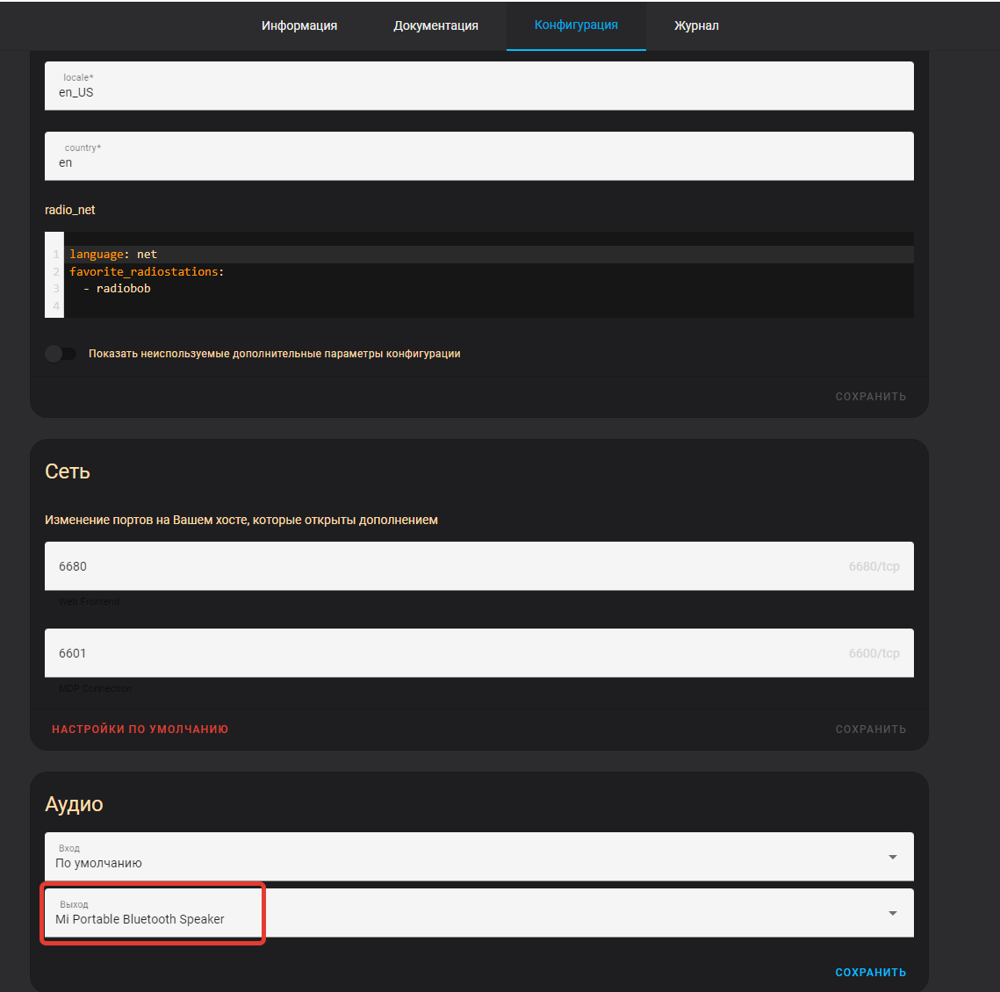
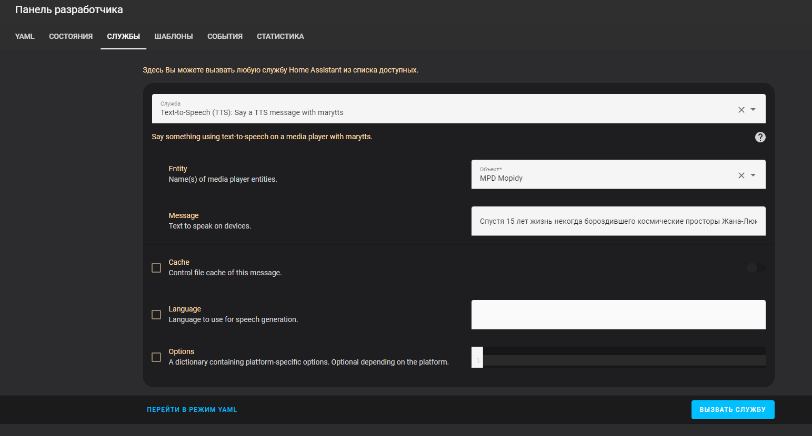

# Вывод звука на Bluetooth колонку

[← Назад к README](../../README.md)

Инструкция зависит от того, как установлен Home Assistant:

- **Home Assistant OS (HAOS)** — воспользуйтесь проектом [TTS Bluetooth Speaker for Home Assistant](https://github.com/pkozul/ha-tts-bluetooth-speaker).
- **Home Assistant Supervised на Debian** — выполните шаги ниже.

## 1. Направить PulseAudio в аудио сервер Home Assistant

Откройте настройки клиента PulseAudio:

```shell
nano /etc/pulse/client.conf
```

Добавьте строки:

```ini
default-server = unix:/usr/share/hassio/audio/external/pulse.sock
autospawn = no
```



Перезапустите PulseAudio:

```shell
pulseaudio -k && pulseaudio --start
```

## 2. Установить Mopidy

Установите аддон [Mopidy](https://github.com/Llntrvr/Hassio-Addons) **версии 2.1.1**. Версию 2.2.0 не ставьте: она сломана, подробности в [issue #334](https://github.com/Poeschl/Hassio-Addons/issues/334).

Добавьте медиаплеер в `configuration.yaml`:

```yaml
media_player:
  - platform: mpd
    name: "MPD Mopidy"
    host: localhost
    port: 6600
```

Полностью перезагрузите Home Assistant, чтобы перезагрузился и Debian:



## 3. Подключить колонку

Подключите колонку к Debian через графический интерфейс или в консоли через `bluetoothctl`:

```shell
bluetoothctl
power on                 # включить Bluetooth
scan on                  # начать поиск устройств
pair <mac адрес>         # создать пару с колонкой
connect <mac адрес>      # подключиться
trust <mac адрес>        # добавить в доверенные, чтобы колонка подключалась сама
```

## 4. Выбрать колонку как устройство вывода

Укажите Bluetooth колонку как устройство вывода звука в аддонах.

Rhasspy Assistant:



Mopidy:



## 5. Проверить

Вызовите действие озвучки на медиаплеере Mopidy:

```yaml
service: tts.marytts_say
data:
  entity_id: media_player.mpd_mopidy
  message: >-
    Спустя 15 лет жизнь некогда бороздившего космические просторы Жана-Люка
    Пикара
```


